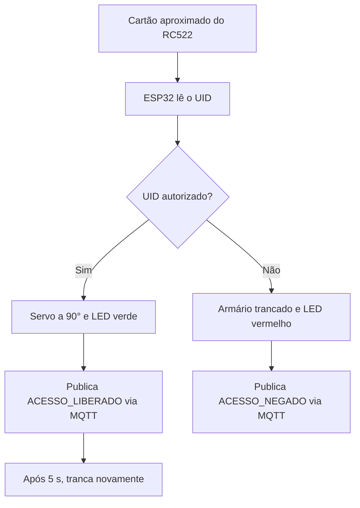

<div align="center">

# 🔐 Armário Inteligente com RFID e MQTT

### Controle de acesso com ESP32, RFID RC522, servo motor e comunicação MQTT


**AC02 · Internet das Coisas (IoT) · 3º trimestre**

**Integrantes:** Ana Elisa e Raphael Ramalho

[▶️ Abrir simulação no Wokwi](https://wokwi.com/projects/478502305775727617) · [🌐 Abrir HiveMQ Web Client](https://www.hivemq.com/demos/websocket-client/)

</div>

---

## 📖 Sobre o projeto

O **Armário Inteligente** utiliza um **ESP32** e um leitor **RFID RC522** para controlar uma fechadura simulada por um servo motor. Quando um cartão é aproximado, o sistema lê seu **UID** (identificador único), verifica se ele está autorizado e registra o resultado por **MQTT**, em formato **JSON**.

| Situação | Comportamento do sistema |
|:--|:--|
| ✅ **Acesso autorizado** | O servo gira para **90°**, o **LED verde** acende e o armário é trancado automaticamente após **5 segundos**. |
| ❌ **Acesso negado** | A fechadura permanece trancada e o **LED vermelho** indica o estado de bloqueio. |
| 📡 **Registro do acesso** | Em ambos os casos, o ESP32 publica um evento JSON no broker MQTT. |

### ⚙️ Fluxo de funcionamento



---

## 🧰 Componentes e tecnologias

- **ESP32:** processamento, conexão Wi-Fi e envio dos eventos.
- **RFID RC522:** identificação dos cartões e tags.
- **Servo motor:** simulação da fechadura.
- **LED verde e LED vermelho:** sinalização visual do estado do armário.
- **Resistores de 220 Ω:** limitação de corrente dos LEDs.
- **MQTT + HiveMQ:** transporte e visualização das mensagens.
- **Wokwi:** simulação online do circuito.

### 📚 Bibliotecas

| Biblioteca | Finalidade |
|:--|:--|
| `MFRC522` | Leitura e identificação dos cartões RFID. |
| `ESP32Servo` | Controle do servo motor. |
| `PubSubClient` | Comunicação com o broker MQTT. |
| `SPI.h` | Comunicação SPI com o RC522. |
| `WiFi.h` | Conexão do ESP32 à rede Wi-Fi. |

> `SPI.h` e `WiFi.h` já fazem parte do ambiente ESP32. No Wokwi, as bibliotecas adicionais são configuradas em `libraries.txt`.

---

## 🔌 Conexões do circuito

### Leitor RFID RC522

| Pino do RC522 | Pino do ESP32 |
|:--|:--|
| SDA / SS | GPIO **5** |
| SCK | GPIO **18** |
| MOSI | GPIO **23** |
| MISO | GPIO **19** |
| RST | GPIO **21** |
| 3.3V | **3V3** |
| GND | **GND** |

### Servo e LEDs

| Componente | Conexão |
|:--|:--|
| Servo, sinal PWM | GPIO **13** |
| Servo, alimentação | **5V** |
| Servo, terra | **GND** |
| LED verde | GPIO **26**, com resistor de **220 Ω** |
| LED vermelho | GPIO **27**, com resistor de **220 Ω** |

> ⚠️ O **RC522 deve ser alimentado em 3,3 V**, não em 5 V.

---

## 🌐 Configuração de rede e MQTT

| Parâmetro | Valor |
|:--|:--|
| **Rede Wi-Fi** | `Wokwi-GUEST` |
| **Broker MQTT** | `broker.hivemq.com` |
| **Porta MQTT do ESP32** | `1883` |
| **Porta do cliente WebSocket** | `8884` (SSL) |
| **Tópico** | `armario/ramalho/A01` |

O ESP32 publica as mensagens no tópico `armario/ramalho/A01`. O HiveMQ Web Client pode se inscrever nesse tópico para acompanhar os acessos em tempo real.

---

## 🚀 Como executar

**1. Conecte o cliente MQTT**

Acesse o [HiveMQ Web Client](https://www.hivemq.com/demos/websocket-client/) e configure:

- **Host:** `broker.hivemq.com`
- **Port:** `8884`
- **SSL:** habilitado

Clique em **Connect** e confirme que o status está como `connected`.

**2. Inscreva-se no tópico**

Clique em **Add New Topic Subscription**, digite `armario/ramalho/A01` e pressione **Subscribe**. Para acompanhar todos os armários desse prefixo, também é possível usar `armario/#`.

**3. Inicie a simulação**

Abra o [projeto no Wokwi](https://wokwi.com/projects/478502305775727617) e clique em **Play**.

No **Serial Monitor**, a sequência esperada é:

```text
Conectando no Wi-Fi... conectado!
Leitor Pronto!
Conectando no broker...
Broker conectado!
```

**4. Teste os cartões**

Clique no leitor RFID, selecione um cartão e pressione **TAP**.

**5. Confira a mensagem**

Volte ao HiveMQ Web Client. O JSON do acesso aparecerá em **Messages**.

---

## 🪪 Cartões e permissões

| Cartão ou tag | UID / regra | Resultado |
|:--|:--|:--|
| 🔵 **Blue Card** | `01:02:03:04` | ✅ `ACESSO_LIBERADO` |
| 🟢 **Green Card** | `11:22:33:44` | ✅ `ACESSO_LIBERADO` |
| 🟡 **Yellow Card** | UID não autorizado | ❌ `ACESSO_NEGADO` |
| 🔴 **Red Card** | UID não autorizado | ❌ `ACESSO_NEGADO` |
| **NFC Tag / Key Fob** | UID não autorizado | ❌ `ACESSO_NEGADO` |

Uma mensagem é publicada **a cada nova leitura de cartão**. Se o mesmo cartão permanecer no leitor com **HOLD** ativo, o sistema gera apenas **uma mensagem** naquela apresentação, pois executa `PICC_HaltA()`.

### 📨 Exemplos das mensagens JSON

**Acesso liberado:**

```json
{
  "armario": "A01",
  "evento": "ACESSO_LIBERADO",
  "uid": "01:02:03:04",
  "tipo_cartao": "MIFARE 1KB",
  "leituras": 1
}
```

**Acesso negado:**

```json
{
  "armario": "A01",
  "evento": "ACESSO_NEGADO",
  "uid": "AA:BB:CC:DD",
  "tipo_cartao": "MIFARE 1KB",
  "leituras": 2
}
```

| Campo | Descrição |
|:--|:--|
| `armario` | Identificação do armário monitorado. |
| `evento` | Resultado da tentativa de acesso. |
| `uid` | Identificador lido do cartão. |
| `tipo_cartao` | Tipo do cartão identificado pelo RC522. |
| `leituras` | Contador acumulado de leituras. |

---

## ✨ Diferenciais implementados pelo grupo

O exemplo de catraca apresentado em aula utilizava um botão para acionar o servo e transmitia uma mensagem simples de acesso. Nosso projeto amplia esse funcionamento com:

1. **Identificação automática por RFID**, sem necessidade de botão.
2. **Reconhecimento do tipo de cartão** pelo byte `SAK`, utilizando `PICC_GetType()` e `PICC_GetTypeName()`.
3. **Montagem do UID com tamanho variável**, conforme os bytes retornados na leitura.
4. **Contador de leituras**, incrementado a cada cartão identificado.
5. **Publicação estruturada em JSON**, contendo cinco campos: `armario`, `evento`, `uid`, `tipo_cartao` e `leituras`.
6. **Travamento automático** após 5 segundos quando o acesso é autorizado.

### 🧑‍💻 Trechos principais do código

- **`publicarEvento()`**: prepara e publica o JSON no broker MQTT.
- **Etapa de leitura em `loop()`**: incrementa `leituras`, consulta o tipo do cartão e processa o UID.

### ⚠️ Limitação observada

Durante os testes com a **NFC Tag**, um UID esperado de **7 bytes** foi recebido com apenas **4 bytes** (`04:11:22:33`). Apesar disso, o **tipo do cartão foi identificado corretamente**. Trata-se de uma limitação observada no teste, e não de uma garantia de leitura integral para todas as tags.

---

## 📁 Arquivos do projeto

```text
📦 armario-inteligente-rfid-mqtt/
├── sketch.ino       # Programa do ESP32
├── diagram.json     # Circuito da simulação Wokwi
├── libraries.txt    # Bibliotecas utilizadas
├── README.md        # Documentação do projeto
└── relatorio.pdf    # Relatório da AC02
```

> A árvore usa os nomes convencionais do Wokwi (`sketch.ino`, `diagram.json` e `libraries.txt`). Confira os nomes reais antes de enviar os arquivos ao repositório.

---

<div align="center">

**Projeto acadêmico · AC02 de IoT · 3º trimestre**

Desenvolvido por **Ana Elisa e Raphael Ramalho** 💻

[🔗 Testar no Wokwi](https://wokwi.com/projects/478502305775727617)

</div>
